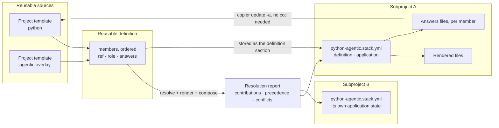

# Stack specification

Status: draft, version 0.1. Owner: bdavis. Last reviewed 2026-11-22.

This document defines the data structures `ccc` uses to describe a stack and
its application to a project. It is the authoritative source for those
structures. The [protocol](stack-protocol.md) defines the operations over
them; [copier-cat vs copier](copier-cat-vs-copier.md) explains them to users
and is derived from this document and the protocol, never written
independently.

## Goals and non-goals

The specification exists so that a stack is an inspectable artifact rather
than something hidden in a session, an agent prompt, or a tool's memory.
Two properties matter more than any field:

- A stack definition is **reusable input**, stored in the subproject's
  `<stack name>.stack.yml` alongside its own application state. A catalog may
  additionally hold reusable definitions; no separate stamp file is required.
- A stamped project remains understandable and updatable **without `ccc`**.

Non-goals for this version: template inheritance, a competing renderer, an
universal merge for arbitrary file formats, and multi-runner execution.

## Vendor neutrality

The specification is defined in terms of an abstract **runner**, not Copier.
Copier is the only runner implemented today, and no second runner is
committed to. The abstraction is a seam, not a promise, and follows
decision-7 item 3: templates must never be redesigned around a hypothetical
second runner.

Three rules keep the seam honest:

1. Every runner-specific concept is confined to a `runner` object, never
   promoted to a top-level field. A stack definition with no Copier-specific
   keys must remain meaningful to a reader who has never used Copier.
2. The neutral terms are **source**, **ref**, **answers**, and
   **application state**. Copier's `_src_path`, `_commit`, answers file,
   and update command are one runner's *projection* of those terms.
3. A runner may decline an operation it cannot express. Unsupported is a
   reported outcome, never a silent downgrade.

Future candidates named by the maintainer 2026-11-22 — Cookiecutter, cruft,
and template libraries from other language ecosystems — are motivations for
this shape, not current work. Nothing here requires or implies their
implementation.

## Artifacts

Two artifacts, versioned independently, specified together in this one
document so that an extracted stack specification carries both with it:

- **`<stack name>.stack.yml`** — the project-local stack artifact. Its
  `definition` section says what was requested; its `application` section
  records what was applied to this subproject. The two sections share a file,
  not a lifetime or an editing policy.
- **Resolution report** — review evidence for composition and conflicts.
  Copier's native per-template answers files remain separate and authoritative
  for native updates.

One definition can be applied to many subprojects, each with its own
application state. Native answers files keep plain Copier updates working
after `ccc` is removed.

### `<stack name>.stack.yml`

One project-local file holds the stack definition and the application state.
A reusable catalog may also contain definitions, but importing one does not
create a second application-state file. The per-template answers files remain
separate because Copier owns their format and native update lifecycle.

For a named stack, the filename is its stable stack name plus `.stack.yml`.
An anonymous one-template stack uses its member id, so applying template
`python` writes `python.stack.yml`. Applying several anonymous stacks to one
subproject must not overwrite an existing stack artifact: the operation stops
for an explicit stack name. Existing `*.stack.yml` files are never silently
replaced.

#### Definition section

The `definition` section contains the complete, ordered input for applying
templates. One template is a valid one-member stack and needs no
composition-specific configuration.

| Field | Required | Meaning |
| --- | --- | --- |
| `schema_version` | yes | Integer. Consumers must reject a major version they do not understand. |
| `name` | for a named stack | Stable identifier within a catalog. An anonymous stack omits it. |
| `members` | yes | Ordered, non-empty list of member objects. |
| `composition` | no | Declared precedence rules and format adapters. Absence means review on collision. |
| `requirements` | no | Explicit constraints a consumer must validate, such as at least one base. |

Each member carries:

| Field | Required | Meaning |
| --- | --- | --- |
| `id` | yes | Stable identity for this member within the stack. Used in reports and diffs. |
| `source` | yes | A runner-compatible template source. |
| `ref` | no | Requested version: a tag, commit, or mutable reference. |
| `role` | yes | `base`, `specialization`, or `overlay`. A role never implies incompatibility. |
| `answers` | no | Literal answers, or references to named answer inputs. |
| `runner` | no | Runner-specific settings, namespaced by runner name. |

A stack definition never contains another project's answers. Fresh
application does not depend on the state of any previously stamped project.

#### Application section

The `application` section records what was actually applied to this
subproject. Where the definition is what was *asked for*, application state
is what *happened*.

Several subprojects can share a definition and diverge, because each resolved
its refs at a different time and answered its questions differently. The
application state is therefore per-project even though it shares a file with
the definition. Reusable definition edits are reviewed separately from
application-state updates. Application state is append-only at the record
level: a corrected state supersedes its predecessor rather than silently
rewriting it (principle 7).

Application state makes no-op detection, interrupted-run recovery, and later
upgrades possible.

| Field | Meaning |
| --- | --- |
| `schema_version` | Record format version. |
| `project` | Identity and root of the subproject. |
| `stack` | The stack `name` if named, plus the digest of the definition used. |
| `members` | Per member: `id`, resolved `source`, resolved `ref` or content digest, resolved answers, and the runner's native stamp locator. |
| `composition` | The composition rules and adapter versions actually used. |
| `native` | Per member, the native update command and the native answers path. |
| `report` | Reference to the resolution report produced at application time. |
| `status` | `preview`, `applied`, `partial`, or `superseded`. |

`partial` is a first-class value, not an error to hide. An interrupted run
records which members were applied so the next run can resume instead of
re-applying them (principle 6).

The stack artifact is disposable. Deleting it must not impair any member's
native update lifecycle, because `application.native` points at answers files
the runner itself owns. Removing it loses orchestration history, not native
updates.

### Resolution report

The reviewable evidence produced by resolving and composing a stack:
contributors, stable contribution identities, precedence rules applied,
unresolved overlaps, validation results, and the native commands a user
could run without `ccc`. It is not required for plain runner use.

## Identity and no-op detection

A run is a no-op when the resolved inputs are unchanged. Resolved inputs are
the tuple of source, resolved ref or content digest, answers, ordering, and
composition options for every member, compared against the `application`
section.

Two tiers, cheapest first:

1. **Identity comparison.** Resolved refs and digests match. No render, no
   writes — including no rewrite of native answers files.
2. **Content comparison.** Required when identity cannot prove equality:
   a plain directory source, or a mutable ref whose contents may have moved.
   The runner renders into an isolated preview and the resulting
   contributions are compared read-only.

Local project drift is reported separately and never by itself triggers
reapplication. Drift is a fact about the project, not evidence that the
stack changed.

## Versioning of stacks

The maintainer asked for predictable version movement as a stack changes
(2026-11-22, Q19). The rule for this version:

- Stack `members[*].ref` values are the only version selectors. `upgrade`
  never takes an ad-hoc per-template version override, because that would
  diverge a project from its stack with no reviewable diff to explain it.
- Changing a version is a **stack edit**, which produces a reviewable
  definition diff, separate from the project diff it later causes.
- Predictable increments are a `ccc stack` concern: resolving a ref to its
  latest matching tag, or advancing within a declared range, is computed
  from the runner's own version ordering. For Copier that ordering is PEP
  440 over git tags, with pre-releases opt-in.

Automatic version incrementation policy — when a stack edit should move a
ref at all — is an open question carried in `backlog/drafts/` (draft-5), not
settled here. The safe default is that refs change only by explicit stack edit.

## What plain Copier can and cannot do

This boundary is a requirement, not an aspiration, and is the subject of
observable tests rather than documentation alone.

After `ccc` has applied a stack, with `ccc` then removed:

| Operation | Supported by plain Copier |
| --- | --- |
| Update one stamped member through its own answers file | Yes |
| Update several stamped members | Yes, as separate user-run operations |
| Update a member added by a later stack extension | Yes, once that extension was applied and stamped |
| Discover and apply a new stack extension | No — requires `ccc` or a manual native equivalent |
| Reproduce whole-stack composition, attribution, or compatibility reports | No |
| Recover an interrupted multi-member application as one operation | No |
| Remove a member and its contributions | No — not provided by `copier update` |
| Resolve new cross-template conflicts automatically | No — native conflicts stop for review |

The summary: `ccc` adds orchestration. Removing it loses orchestration, never
the per-template lifecycle.

## Specification maintenance

The maintainer asked how this specification survives Copier's evolution
(2026-11-22, Q11).

- This file is the source of truth for structure; the protocol is the source
  of truth for behavior. The user-facing comparison document derives from
  both and must be regenerated in the same change that alters either.
- Each artifact carries `schema_version`. A breaking structural change
  increments the major version and records a migration note here.
- Runner projections are verified against the installed runner version and
  the result recorded as evidence, rather than assumed from memory. Copier's
  command surface was verified against 9.19.1 on 2026-11-22.
- When Copier changes a behavior this specification depends on — answers
  filtering, update computation, answers-file naming — the change is a spec
  change and gets a recorded decision, not a silent edit.
- Structural claims in this document are checked by tests at the composition
  library's public boundary, not by prose review alone.
